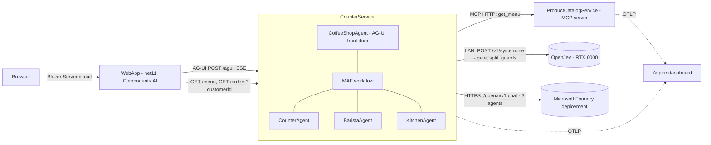
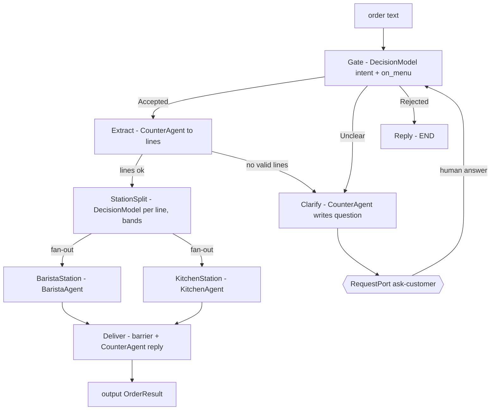
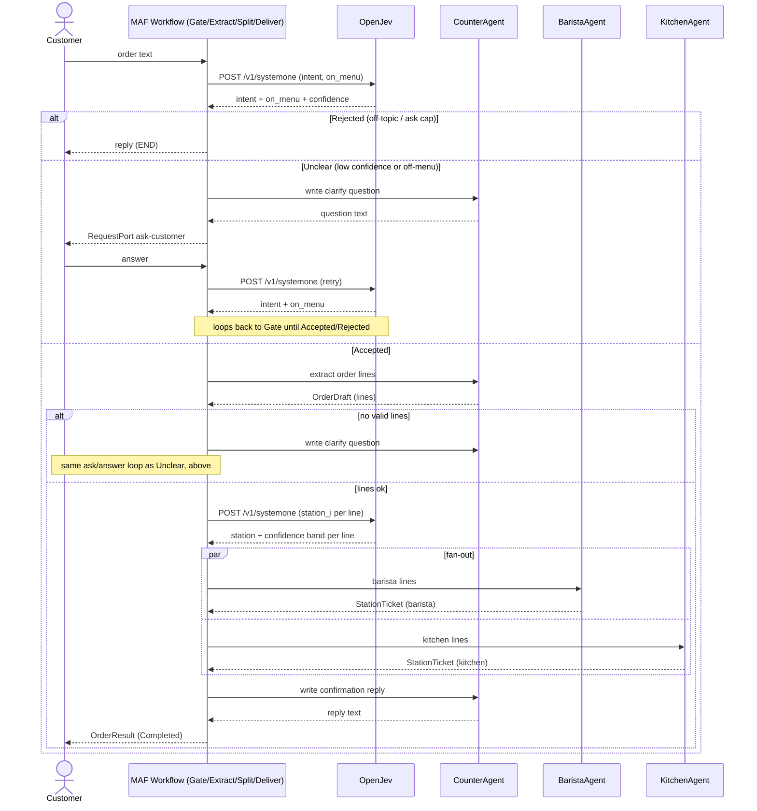
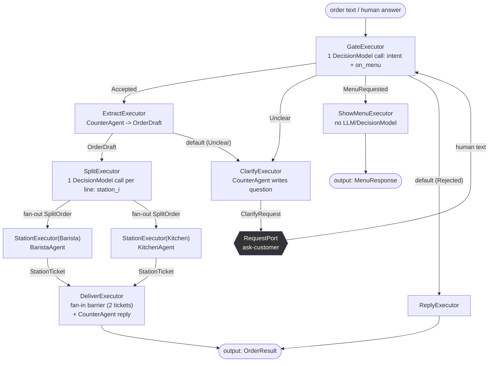

# coffeeshop-decisionModel

Coffee-shop ordering demo: .NET 10 services + a .NET 11 Blazor front end (AG-UI) + Aspire + Microsoft Agent Framework, using [DecisionModel](https://docs.typesafe.ai/introduction)/OpenJev for intent- and confidence-routing instead of an LLM. 3 in-process MAF agents (Counter, Barista, Kitchen).

Design + rationale: `research.md`. Task breakdown: `tasks.md`.

## Runtime



## Workflow (Microsoft Agent Framework)



Same workflow, as a sequence diagram:



## Prerequisites

- .NET SDK `11.0.100-rc.2.26504.105`+ (`global.json` pins it). Only `WebApp` and `AppHost` target net11 (the Blazor `Components.AI` preview is net11-only); every other project stays on net10. Why: `jev_routing_research.md` §17.6
- [Playwright CLI](https://playwright.dev) (`playwright-cli`) for the UI acceptance run
- A reachable OpenJev server (`/v1/systemone`)
- An OpenAI-compatible chat endpoint (Foundry, or any compatible gateway) for the 3 agents

## Configure secrets (once)

```bash
cd src/AppHost
dotnet user-secrets set "decision-model-url" "http://<your-openjev-lan-host>:<port>"
dotnet user-secrets set "decision-model-api-key" "<key, only if the server enforces one>"
dotnet user-secrets set "openai-base-url" "https://<your-endpoint>/v1"
dotnet user-secrets set "openai-model" "<model-name>"
dotnet user-secrets set "openai-api-key" "<key>"
```

`decision-model-url` is the decision-model (OpenJev) server's base URL; the client appends `/v1/systemone`. Use the LAN URL above for your local OpenJev server, or set it to `https://api.typesafe.ai` to use hosted DecisionModel. `AppHost` passes this exact URL to CounterService, including its scheme, so both HTTP and HTTPS work. Change the same setting to switch endpoints; AppHost reads it via `Parameters:*` (see `AppHost.cs`). Keep API keys in user-secrets, not in committed settings files.

## Run + debug (Aspire)

```bash
aspire run
```

Or press F5 in VS Code / Rider with `AppHost` as the startup project — breakpoints in `CounterService`/`ProductCatalogService` work normally, Aspire attaches to both.

`aspire run` prints the dashboard URL with a login token:

- **Dashboard**: `https://localhost:17214/login?t=<token>` — traces, logs, resource health. GenAI-enriched spans for both the OpenJev calls and the agent LLM calls (`chat jev-latest`, `chat <model>`).
- **Web UI (WebApp)**: `http://localhost:5200` - Order chat + ticket rail, Menu board + cart, Your orders. The only entry point for customers.
- **Counter API**: `http://localhost:5100` (`/agui`, `/menu`, `/orders`, Scalar at `/scalar`)
- **Catalog API**: `http://localhost:5101`

### Acceptance tests (UI)

With the stack up (`aspire run --detach`), `WebApp/acceptance/run.sh` drives the real UI through `playwright-cli` (one scenario per file: golden path, clarify turn, off-topic, menu + cart, history, ask cap, UI/UX). It uses the real DecisionModel and LLM, so a full pass takes a few minutes; pass scenario ids to run some (`run.sh A1 A4`). Offline tests, including the AG-UI contract tests (`AguiEndpointTests`), run with `dotnet test tests/CoffeeShop.Tests`.

If `decision-model-url` is unreachable, `counter` still starts (fails closed at the call site, not at startup).

## Run evals (DecisionModel as judge)

Live evals hit the real OpenJev + chat endpoint — same secrets as above (`EvalConfig.cs` reads the same AppHost user-secrets store, no extra setup). If secrets aren't configured, these tests **fail fast** with the exact `dotnet user-secrets set` command to run — they don't skip silently.

```bash
# offline only (fast, no network, runs in CI)
dotnet test tests/CoffeeShop.Tests

# gate + station accuracy against real DecisionModel
dotnet test tests/CoffeeShop.Evals --filter "GateEvals|StationEvals"

# DecisionModelJudge accept/escalate cascade (DecisionModel judges; low-confidence items escalate to the LLM)
dotnet test tests/CoffeeShop.Evals --filter "JudgeCascadeTests|DecisionModelJudgeEscalationTests"

# variance smoke check (30 repeated reads x 3 frozen tickets)
dotnet test tests/CoffeeShop.Evals --filter "DecisionModelJudgeVarianceTests"

# build the combined report from whatever ran above
dotnet test tests/CoffeeShop.Evals --filter "FullyQualifiedName~CoffeeShop.Evals.Report"
```

Report: `tests/CoffeeShop.Evals/bin/Debug/net10.0/evals/out/report.md` (gate/station accuracy, DecisionModelJudge accept/escalate/human-review counts per rubric item). Variance detail: `evals/out/judge-variance.md`.

Design + what's implemented vs. descoped: `research.md` §10 (esp. §10.6a, §10.9).

## Order details (audit + AG-UI log)

Every order the front door finishes, placed or refused, is stored with an `OrderTrace`: the conversation that led to it, the decision-model provider and model, an **audit log** (message, provider, gate decision with intent and confidences, station split, tickets, result) and the **AG-UI events** it streamed (`RUN_STARTED`, `STATE_SNAPSHOT`, `TEXT_MESSAGE_CONTENT`, `RUN_FINISHED`), each with a timestamp. Open it from Your orders (`#6` or "Order details…") at `/orders/{number}`, or `GET /orders/{number}` on the counter API; the page also shows the raw JSON. In memory only, like the order store, so it is gone after a restart. Orders placed through the legacy `POST /orders` path have no trace.

## Decision model providers

The decision model is any server that speaks `POST /v1/systemone`. Pick one with the AppHost parameter `decision-model-provider`. That one value selects the whole endpoint: the URL and key come from `decision-model-{provider}-url` / `decision-model-{provider}-api-key`, and the model name comes from the provider's profile, so they cannot drift apart (a laya model name sent to the TypeSafe URL is `400 Unknown model: english`, and the order is refused as "ordering is offline"). Example `Parameters` in `appsettings.Development.json` or user-secrets:

```json
"decision-model-provider": "typesafe",
"decision-model-typesafe-url": "https://api.typesafe.ai",
"decision-model-typesafe-api-key": "<key>",
"decision-model-openjev-url": "http://<lan-host>:8686",
"decision-model-openjev-api-key": "",
"decision-model-microsoft-url": "https://<res>.services.ai.azure.com",
"decision-model-microsoft-api-key": "",
"decision-model-microsoft-model": "<deployment-name>",  // e.g. ms-dm-test: `az cognitiveservices account deployment list`
"decision-model-laya-url": "http://localhost:8002",
"decision-model-laya-api-key": "local-test",
"decision-model-custom-url": "https://your-endpoint",
"decision-model-custom-api-key": "<key>"
```

`decision-model-{provider}-model` sets the model name (for `microsoft` that is the deployment name; for `laya` you can name another checkpoint). The plain `decision-model-url` / `-api-key` / `-model` still work as a fallback when a provider has no keys of its own. If the Gate's call fails, the order page's audit log has a `gate-error` row with the HTTP status and the server's message. Each provider is a `DecisionProfile` (`Workflow/DecisionProfile.cs`): the model name plus the cut-offs the policies use, because every threshold was tuned on one provider.

| Provider | URL | Model | Intent conf. | Station split | Notes |
|---|---|---|---|---|---|
| `typesafe` (default) | `https://api.typesafe.ai` | `jev-latest` | 0.5 | by the model | what the thresholds were tuned on |
| `openjev` | your OpenJev server, e.g. `http://<lan-host>:8686` | `jev-latest` | 0.5 | by the model | self-hosted; the server the thresholds were first tuned on. Key optional |
| `microsoft` | Foundry resource endpoint, e.g. `https://<res>.services.ai.azure.com` | your **deployment name** (default `Microsoft-Decision-1`) | 0.7 | by the model | Microsoft-Decision-1. Posts to `/providers/microsoft/v1/systemone` (the URL may also be the portal's `…/providers/microsoft` or the full `…/providers/microsoft/v1/systemone`); key in the `api-key` header, or **no key = Microsoft Entra ID** (`DefaultAzureCredential`: `az login` locally) |
| `laya` | `http://localhost:8002` | `english` | 0.1 | **from the catalog** | local `laya-serve`; the Gate asks four yes/no questions (`GateMode.Noul`); see limits below |
| `custom` | your endpoint | `DecisionModel:Model` | default, override below | default | any compatible server |

Override anything per run with config keys `DecisionModel:Model`, `DecisionModel:SplitWithModel` (`false` = take stations from the catalog) and `DecisionModel:Thresholds:{IntentConfidence,OnMenu,StationReview,StationConfirm}`. An unknown provider name fails at startup.

**Laya limits (measured 2026-10-14 on laya 0.3.x, `english` checkpoint).** Its 5-way `choice` collapses to `other` (confidences 0.1–0.3) and it routed every item, even a croissant, to the barista, so the `laya` profile asks **four yes/no questions** at the Gate (`GateMode.Noul`, cut-offs in `IntentPolicy.FromNouls`) and takes stations from the catalog. With that, the whole UI acceptance suite A1–A8 passes. It is still a stand-in: loose wording can become a question, and an off-menu item next to a valid one is dropped silently by Extract (its on-menu answer does not separate, so the Gate ignores it). Two things were real bugs on our side and are fixed for every provider: the Gate `state` used the key `history`, which pulled `intent` to `order_history` for every message (now `previous_messages` / `latest_message`), and thresholds were hard-coded.

## AG-UI front door (`CoffeeShopAgent`)

`POST /agui` (`MapAGUIServer`) hosts `CoffeeShopAgent`, which builds one `OrderWorkflow` per run (`turnBoundary: true`) and maps its events to AG-UI: `order_progress` results become `STATE_SNAPSHOT`s (`OrderUiState`), the menu and history cards are `show_menu` / `show_history` tool results, replies are text. MAF .NET cannot expose workflow interrupts over AG-UI, so clarify is a **turn boundary**: the question ends the run and the answer is the next run. The client echoes `customerId`, `asks` and `history` back in the AG-UI state; the server clamps every field (untrusted input) and never puts raw state into a prompt. The legacy `POST /orders` SSE + `/answer` path is still there for the evals and `EndpointTests`.

## Executor wiring (as built, `OrderWorkflow.Build`)

`src/CounterService/Features/Orders/Workflow/OrderWorkflow.cs` wires 8 `Executor` classes with `WorkflowBuilder`. This reflects the actual code (class names, message types), not the `research.md` §5.2 design sketch — two differences: the split step's real class is `SplitExecutor` (not `StationSplitExecutor`), and a `MenuRequested`/`ShowMenuExecutor` branch (ask-for-menu, no LLM/DecisionModel call) exists in code but wasn't in the original design.



Notes tied to the code:
- `AddSwitch(gate, ...)` routes on message *type* (`Accepted` / `Unclear` / `MenuRequested`), falling through to `[reply]` for anything else (`Rejected`) — `OrderWorkflow.cs:41-45`.
- `extract` and `clarify` share one loop: `ExtractExecutor` falls back to `Unclear` when no valid lines parse, which lands back on `ClarifyExecutor` → `ask` → `gate` again (`OrderWorkflow.cs:46-50`).
- `barista` and `kitchen` are two instances of the same `StationExecutor` class, parameterized by `Station` + `AIAgent` + executor id (`AgentKeys.Barista` / `AgentKeys.Kitchen`) — not two separate classes.
- `AddFanInBarrierEdge` only releases `DeliverExecutor` once **both** stations have sent a `StationTicket`; `StationExecutor` always returns one (real, fallback, or `StationTicket.Empty`) even when it has no lines for that station — otherwise the barrier would hang forever (`StationExecutor.cs:24-26`).
- `DeliverExecutor` reaches across executors via `SplitExecutor.SplitLinesKey`, reading the priced lines `SplitExecutor` wrote into shared per-order state, since the `StationTicket` it receives on the barrier edge carries no price (`DeliverExecutor.cs:32`, `SplitExecutor.cs:16,39`).
- `WithOutputFrom(deliver, reply, showMenu, showHistory)` — these 4 are the only executors that terminate a run; every other executor always sends onward. `showHistory` (`order_history` intent, `HistoryRequested`) lists the caller's orders from `OrderStore`. With `turnBoundary: true` the `RequestPort` loop is replaced by `AskOutputExecutor`, which yields the `ClarifyRequest` as the run's output.
